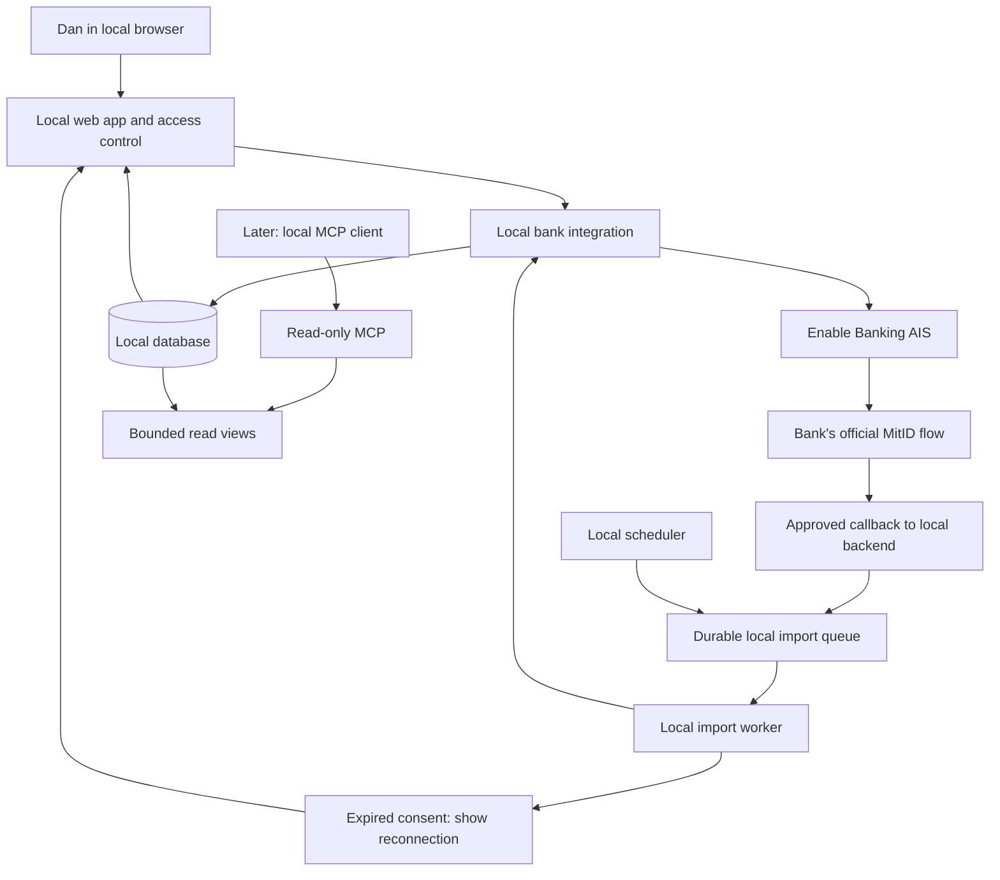

# Banking — local architecture and later Azure

**Superseded runtime design:** on 27 September 2026 Dan confirmed one local/Azure frontend codebase using the deployed production API only. The [current plan](shared-production-backend-plan.md) replaces the local business-backend/database architecture below for normal app development, and replaces visitor-cloned Demo financial data with a persistent shared fictional dataset. Old sections remain historical implementation evidence, not current target instructions. The transition has not yet been implemented.

Status: local backend implemented; future UI/Azure mapping remains a proposal. [Product requirements](../PRODUCT.md) and the [delivery rule](project-plan.md) take precedence. The entire MVP runs locally before approved provisioning/deployment. See [local implementation](local-backend.md).

## Implemented local frontend

ASP.NET Core serves local HTML/CSS/native JavaScript modules from wwwroot on the same HTTPS origin as the APIs. Browser startup consumes a two-minute one-use capability issued through the protected CLI API; the browser receives an eight-hour HttpOnly/Secure/SameSite=Strict protected cookie. The reusable API token never enters browser assets or storage. Non-financial theme/language preferences are stored in the browser, independently of workspace selection.

Financial reads/writes stay behind the existing workspace-aware API. UI state is discarded on account switch and late responses are rejected. There is no external AI client, hosted frontend or Azure dependency. See [local-frontend.md](local-frontend.md).

## Local baseline

- Implement the API, database, separate bank adapter, finance logic, and job worker locally first. The backend must run and be testable without a frontend build or dashboard.
- After backend verification, design the frontend with Dan and implement it only after his design approval. The eventual user interface reads through the API from the owned database; it does not make bank calls on every view. The flow diagram below describes the eventual solution, not permission to build its UI during the backend phase.
- The local backend is C#/.NET 10 with ASP.NET Core and EF Core. SQL Server 2025 LocalDB runs as the dedicated `Banking` instance, using SQL compatibility level 150. API/tests run as x64, including on ARM64 Windows. No Docker or Azure dependency is required.
- A durable local job queue/scheduler and local backup files replace Azure Jobs/Storage. The queue contract may later receive an Azure implementation; jobs must not live only in the web process's memory.
- A local provider simulator with synthetic data enables development and controlled failures. The Enable Banking adapter uses an approved real connection only for live bank testing.
- Local secrets are stored in an OS-protected development store outside the repository. Protected App Service settings and Managed Identity are proposed Azure integrations, not local startup requirements. Key Vault was excluded by Dan on 12 September 2026.
- Local auth is an explicit development mode bound to loopback. No Azure/Entra creation is needed to start locally; production auth is implemented behind the same access boundary.

## Provider-neutral bank contract

### Live/Demo workspaces — confirmed MVP addition

The approved UI presents these through an account selector labeled **Dan** (Live) or **Demo** (Demo). Labels do not change authentication or authorize another user; server workspace enforcement remains unchanged. Theme/language preferences are separate from financial workspace selection. Automatic-budget suggestions and revisions use the selected workspace database; advisor context must be isolated and cleared from the visible conversation when switching.

Server-side workspace selection is implemented at the authenticated request boundary through `X-Banking-Mode`, with separate SQL databases and provider/secret scopes. Application services and schemas are shared. The workspace is fixed for each request/job; there is no process-wide mutable mode flag. Callbacks bind to their originating workspace, background sync stays bound to its connection, and Demo receives only the simulator. Responses return the mode header so the future UI can reject obsolete responses after a switch. Tests exercise isolation using two synthetic workspaces. Live is now enabled after owner consent and local protection verification; initial import and isolation are verified. This is not yet a switchable product UI.

The fictional product demo was created after the real data structure was observed. Banking_Demo and Banking_Live_Dan remain separate; Banking_Local retains the earlier engineering fixtures. ProductDemoProvider supports the same import/finance contracts with invented values. UI switching/cache handling and full product acceptance still require the approved frontend.

The implemented `IBankProvider` contract covers bank discovery, authorization/code exchange, accounts, balances, paginated transactions, and session closure. Consent errors are handled by the connection service and worker; explicit disconnect closes the AIS session and preserves history. No payment operations exist. Local IDs survive same-provider reconnection using stable identity hashes and alternate account aliases. Cross-provider account migration remains a later extension.

Enable Banking: account linking in restricted production and the app's consent flow are two separate steps. The server starts AIS authorization; the browser goes through Enable Banking and the bank's official MitID flow. Callback validation and code exchange take place on the server. Store the session/account mapping and start the import immediately.

The first import uses `strategy=longest`, persists every continuation page to staging, and atomically publishes transactions after the complete fetch and balance retrieval. Checkpoints resume across host restarts. Later sync overlaps the last 30 days. Six hours is the simulator's starting interval, with per-bank configuration for longer intervals and provider Retry-After handling; this is not verified compliance with Danske Bank's quota. Requests contain no fabricated PSU headers. Consent expiry preserves history and requires explicit reconnection.

## Local solution flow

Live Enable Banking and callback require separately approved onboarding. The diagram does not describe an already-created connection. A local simulator replaces the provider flow during development.

## Earlier Azure mapping — superseded proposal

| Local component | Proposed Azure service |
|---|---|
| Web app/API and internal bank integration | Container Apps Consumption with separate identities |
| Worker and scheduler | Container Apps Jobs |
| Relational database | Azure SQL Database Basic, initially under 2 GB |
| Job queue and backup/export | Storage Account: Queue and Blob |
| Secret/signing adapter | Encrypted App Service settings; signing in server memory, no Key Vault |
| Production login | Entra ID, only Dan's concrete tenant/user ID |
| Images and operational monitoring | Container Registry Basic and Azure Monitor |
| Later MCP | Separate Container App, OAuth, and database identity with read-only permissions |

Subscription: Dan Aakesen. Administration account: Dan@novaro.dk. West Europe is proposed, not yet selected/verified for release. No resources or registrations have been created.

The baseline uses HTTPS on public service endpoints with identity controls and an appropriate service firewall. A public endpoint does not mean anonymous data access. Stable egress and precise firewall boundaries must be resolved in the release proposal without automatically choosing broad permissions. VNet, Private Endpoints, and Private DNS are excluded; see only the optional item after the [project plan](project-plan.md).

After approved deployment, the already-imported local history and user corrections are moved securely to Azure with reconciliation and rollback capability. A new import must not be the only migration strategy because older bank history may no longer be available. Callback/session continuity is resolved, and any reauthorization is completed by Dan. Never automatically delete the local original history.

## Next-release architecture decisions — 12 September 2026

See [current Azure release proposal](azure-release-plan.md) and [roadmap](roadmap.md). App Service with CLI/Bicep is now recommended; no Key Vault. The earlier Container Apps mapping above is historical: validate production hosting and durable worker behavior against the implemented ASP.NET application before choosing services. Resolve production access for Dan's private Gmail separately from Azure administration with Dan@novaro.dk; do not silently preserve an older owner-identity assumption. Windows DPAPI/local-only hosting and LocalDB require appropriate production adapters, secure migration and testing.

Actual advisor/voice is now planned. Proposed flow: authenticated Banking UI → application-managed GPT-Live delegation → Agents API analysis using scoped read-only Banking tools → returned text, speech and analysis artifacts. This is a design to prototype, not an implemented connection. OpenAI-hosted compute is outside the Azure subscription; approved data handling and costs are prerequisites to real-data activation. Application credentials and unrestricted database access must not enter the sandbox. Azure continues to own the financial system of record. No automatic assumption of Azure OpenAI availability for these APIs.

