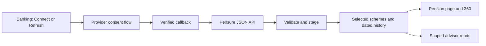

# PFA pension API integration — proposed plan

27 September 2026. Research and design only; no provider account, consent, API connection, deployment or pension data changes made.

## Recommendation and evidence

Pursue PFA data through PensionsInfo and Pensure, subject to access approval. No public self-service PFA developer API was verified in this research; that is not proof that no partner API exists. Do not build against private Mit PFA browser endpoints.

- PFA confirms it supplies PensionsInfo. Incomplete responses can occur, and payout projections may differ from Mit PFA. Preserve provenance rather than promising identical results. [PFA help](https://www.pfa.dk/hjaelpecenter/)
- Pensure documents a hosted collection flow, webhook/return redirect, server credentials, structured JSON retrieval and final export acknowledgement. Acknowledgement triggers later provider-side deletion. This is programmatic transfer even though the endpoint contains `file/data`; the user handles no files. [API guide](https://pensure.dk/api-dokumentation)
- Pensure advertises MitID and PensionsInfo integrations. Its public technical guide still references NemID: obtain the current contract before implementation. [Current product](https://en.pensure.dk/losninger/robo-advice)
- The documented payload includes scheme values/dates, pension types, payment-related fields, age-based forecasts, payout metadata and insurance benefits. These are schema possibilities, not verified coverage of Dan's PFA products. [Payload reference](https://api.demo.pensure.dk/)

No published evidence reviewed establishes unattended recurring refresh. Plan a user-initiated consent flow until the provider confirms otherwise. Access eligibility, fees and refresh permissions remain unresolved. The earlier 13 September mailbox check is historical; no mailbox was checked this time.

## Existing implementation

The current pension page was inspected in the local browser. It contains a tall summary, manual statement action, JSON upload, recorded products and an access-pending notice. These do not constitute an API connection.

`Providers/PensionStatement.cs` is a case-insensitive balance preview mapper. It deliberately omits insurance/projections and does not persist data. `Services/WealthService.cs` stores one current value per named product, plus one optional annual projection/age; it cannot represent provider snapshot history or several retirement scenarios. The advisor already consumes saved wealth. Extend these boundaries instead of introducing a second total.

## Proposed user journey

1. Pension page: **Connect PFA**. Explain that collection is through PensionsInfo/Pensure and what Banking will retain. Permit choosing which returned schemes to include.
2. Banking creates a short-lived, owner-bound collection session and opens the provider-hosted consent flow. Dan completes identity verification there; Banking never receives MitID credentials.
3. On return, display actual stages: waiting for consent, receiving data, checking schemes, ready. A redirect alone never means success.
4. Backend validates the callback, retrieves structured data, and creates a durable staging result. Show included PFA schemes, source dates, missing providers and possible matches to manually recorded products.
5. **Use these pension schemes** confirms initial selection and any manual-to-connected replacement. Later valid refreshes update the already selected schemes. Never silently combine an old manual PFA value and its new connected version.
6. **Refresh pension** begins another collection when consent is required. Keep the last successful snapshot visible after cancellation/failure, with its actual date. **Disconnect** stops future collection; deleting retained history is a separate action.

## Proposed backend design

- `PensureClient`: bounded requests, fixed allowed hosts, encrypted credentials/tokens, schema version checks and redacted diagnostics. Use the documented JSON endpoint server-to-server, not browser downloads or uploads.
- `PensionCollection`: owner/workspace, opaque random state, provider transaction identifier, expiry, stage and failure category. Callback authentication/signatures or another agreed authentication mechanism are an access prerequisite; random state alone is not provider authentication.
- `PensionScheme`: provider identifier plus protected external scheme reference, display name, currency, pension type and user inclusion choice. Use a keyed lookup identifier; display only a masked reference. Never deduplicate using a name or final four digits alone.
- `PensionSnapshot`: scheme, source valuation date, received time, collection ID, value and completeness. Repeated callbacks are idempotent. An absent scheme in a partial delivery is not a zero balance or deletion. Quarantine incompatible schema and retain prior accepted data.
- Separate optional records for contributions, projections and coverage. Preserve payout frequency, tax treatment, retirement age, finite/lifetime duration, calculation date and assumptions. Do not convert a contribution to monthly unless its period is known.
- Commit the validated, selected-scope durable staging data and recovery receipt before acknowledging provider export. Agree acknowledgement timing for rejected/partial payloads and staging retention with Pensure. Never acknowledge before recoverable storage; retry acknowledgement independently of importing.
- Minimize sensitive data: no CPR, spouse details or health records in ordinary logs, URLs, frontend state or advisor context. Protected short-lived recovery payload retention, if required, needs an explicit retention policy; normalized selected pension facts are the default persistent data.
- Proposed app routes: start collection, callback, collection status, select schemes, pension overview/history/projections and disconnect. Names/contracts are design proposals, not implemented endpoints.

The confirmed shared-backend architecture supersedes separate local provider runtimes: both local and Azure frontends use one deployed API. Collection sessions, credentials, verified webhooks and ingestion live in Azure. Register the agreed Azure callback once per provider environment; no localhost callback or development tunnel is needed for normal frontend work. Resume from the same owner-bound collection status through either frontend after consent. Provider test mode and Banking Demo must stay isolated from Dan's real pension.

## Page and data design

Replace the manual-import-first layout with the following compact structure. Match Banking's themes, scenic header and single-title rule; no decorative single-edge borders.

| Area | Component | Rule |
| --- | --- | --- |
| Header | Pension; PFA status and Refresh aligned right | One compact row; controls wrap on phone |
| Summary | Capital, reported contributions, projected income at selected age | Only supported facts; dates stay visible; missing fields say unavailable |
| Main left | Pension capital history with dated observation points | One snapshot shows a value, not an invented trend; balance changes are not returns |
| Main right | Retirement-age selector and payout timeline | Use provider-supported ages; distinguish lifelong and time-limited payments |
| Below | Scheme cards with type, balance, date and expandable detail | Stable colors across page and 360; full-width on phone |
| Optional | Insurance coverage cards in a separate section | Never add insured amounts to pension capital |

Desktop: two equal-width main panels. Tablet: two columns only while each retains at least 320px content width; otherwise stack. Phone: compact summary carousel with accessible navigation, then one chart per row and expandable scheme cards. Use content-width boundaries to account for the sidebar; no nested page scrollbars.

Keep capital, projections and insurance visually distinct. Show a reported annual payout as monthly only when meaningful, explicitly as annual/12, with its original tax/price basis; do not call that a guaranteed monthly payment. Do not invent fund holdings, fees, historical returns or salary/employer contribution splits. Add these only after genuine payload evidence.

360 uses each selected scheme's latest accepted capital once. Compare aligned observations for history, show incomplete totals and dates, and retain pension as inaccessible retirement wealth. Replace the existing Demo-only contribution/return visual with real supported metrics in Dan's workspace. The AI gets normalized balances, scheme details, supported scenarios, coverage and freshness; provider credentials, raw identity data and ungrounded tax calculations remain excluded.

## Delivery sequence and acceptance

1. **Access gate:** obtain current Pensure terms, pricing, personal-use eligibility, sandbox keys, MitID flow, callback authentication, exact PFA field coverage, consent renewal and acknowledgement/retention rules. Ask PFA about a supported direct read API as a parallel fallback enquiry. No enquiries have been sent.
2. **Proof of connection:** one consented sandbox collection into a staging screen, then one owner-authorized real collection. Reconcile all returned PFA scheme values and dates against the source; establish coverage before building optional charts.
3. **Persistent connector:** migrations, protected identifiers, idempotency, partial results, snapshot history, reconciliation of manual records, disconnect and freshness. Tests cover duplicate/reordered callbacks, expired or wrong-owner state, missing PFA, invalid dates/currencies, storage failure before acknowledgement and acknowledgement retry.
4. **Pension UI and advisor:** implement the compact design, 360 aggregation and read-only pension tools. Browser-check desktop/tablet/phone, keyboard navigation, loading, cancellation, partial delivery and reconnect. Verify save/reload and totals against API evidence.
5. **Deployment:** register the agreed Azure callback and deploy the reviewed connector with explicit approval. Both frontends use that connector. Extend CONNECT-02 acceptance with real provider evidence; never mark it passed on fixtures alone.

The immediate next action is provider access clarification, not another file importer. If Pensure will not onboard a personal app, the documented route is blocked; reassess a supported PFA partner connection before considering another architecture.

## Access follow-up - 27 September 2026, after shared-backend deployment

Rechecked Pensure's public API guide, product page and contact page. The guide still documents manually provisioned API keys plus a per-collection token, structured JSON retrieval and final export acknowledgement. It still refers to NemID while the product page advertises MitID. Treat it as evidence of a supported integration pattern, not a verified current production contract. Personal-use eligibility, price, authenticated callback verification and unattended refresh remain unconfirmed.

A focused personal Gmail search for `pensure` returned no messages on this check. That result does not establish whether contact occurred through another mailbox or a web form. No enquiry was sent. The ready-to-review enquiry is in [Pensure access enquiry](pensure-access-enquiry.md); the published recipient is kontakt@pensure.dk ([contact source](https://pensure.dk/kontakt)).

Work available without Dan at home: provider access enquiry after send authorization, current schema/consent contract review, a sandbox proof once credentials are issued, then the adapter and safe ingestion tests against the confirmed contract. Dan's identity/consent remains his own step; there is no verified unattended feed to activate now. Avoid speculative connector endpoints or fabricated provider responses presented as a connection.
