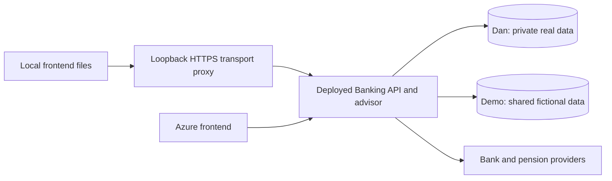

# One app, one production backend

Status: architecture confirmed by Dan on 27 September 2026; implementation authorized and started with GPT-6 Luna / Max subagents. Deployment, credential changes, database deletion and migration execution remain separate approval boundaries. Dan is concurrently editing loading animations and page UI: these agents must not edit the active frontend trees or interrupt the running app without coordination.

## Confirmed outcome

The same Banking frontend code runs from localhost during UI development and from Azure after deployment. Both call the same deployed production API. That API owns the existing Azure Dan and Demo databases and provider integrations. There is no local application database, local business API, local advisor service or local sync worker in the normal development launcher, and no direct SQL access from localhost.

Dan and Demo remain separate authenticated workspaces. Dan's real data is owner-only. Demo is one persistent shared fictional financial dataset, editable through either frontend; local Demo edits must appear in the deployed Demo and vice versa. This supersedes the old per-visitor disposable financial-copy design. Sharing Demo financial records does not authorize exposing private advisor conversations, memories, uploaded artifacts, credentials or real Saxo accounts between visitors.

Local frontend edits remain local until deployed. Data writes from localhost affect the selected production workspace. Backend changes become available to either frontend only after a controlled backend release. Isolated disposable databases and mocked APIs remain permitted for automated backend tests; they are not the running local app's data source. Existing local data files are retained untouched, not deleted or uploaded.

## Transport design

Use a small frontend-only HTTPS development host on the existing localhost:5443 origin. Serve the repository's static frontend files; forward approved API and dynamic advisor requests to the fixed Azure Banking origin. This proxy is transport only: no financial calculations, user authorization decisions, provider tokens, SQL clients, migrations, seeders or fallback API implementations.

The production backend still authenticates and authorizes every request. The existing browser uses relative URLs, same-origin credentials, Strict cookies and same-origin checks; blindly changing a base URL would break those assumptions. The proxy preserves browser-facing same-origin behavior without broad CORS or weaker cookie settings.

- Bind to loopback only, enforce the exact localhost host/port and validate Origin plus applicable fetch metadata before forwarding. Reject hostile origins, unexpected hosts and state-changing requests without a valid origin. Avoid an open proxy or localhost CSRF bypass.
- Upstream is a fixed HTTPS origin with normal certificate validation. No user-supplied target, arbitrary upstream redirect following or credential forwarding to other domains. Normalize paths and reject traversal/encoded bypasses.
- Forward only needed headers, bodies, cookies and workspace context. Strip spoofable internal identity/session/scope headers and hop-by-hop headers. After validating local requests, map upstream Host/Origin where required; never trust arbitrary forwarded identity headers.
- Pass production-issued opaque session cookies through only with valid host-only Secure/HttpOnly semantics and appropriate paths. Never decrypt or mint owner sessions locally. Separate local and Azure browser logins are acceptable; shared data does not require shared browser cookies. Logout must invalidate the correct upstream session.
- Do not log passwords, cookies, financial payloads, voice tokens or OAuth query strings. No browser localStorage bearer-token workaround and no production database/provider secrets on the development machine.
- Stream responses without buffering complete AI runs. Preserve status codes, content types, cancellation and supported streaming behavior. Handle expiry, rate limits, unavailable upstream and incompatible API versions explicitly; never switch to local sample data.

## Advisor, artifacts and provider redirects

Classify routes before coding: app static assets, advisor static assets, `/api/*`, `/advisor/api/*`, generated artifact documents/media, health/legal routes, and provider auth/callback routes. Add explicit route tests so a static-file fallback can never answer an API request.

Serve local advisor UI files when editing them, while all advisor execution, tools, persistence and voice session creation use the deployed service. Preserve the existing generated-artifact isolation and CSP; untrusted artifact code must not gain access to the user's API/session merely because it is proxied. Verify embedded frame messages/origins, asset URLs, authenticated media and voice permissions/WebRTC against the actual deployed contract.

Provider OAuth consent and token storage remain on Azure using registered production callbacks. Local UI starts the production flow and refreshes status after completion. Prefer an explicit return link to the local app. Do not transplant OAuth cookies/state or add arbitrary return URLs. If a seamless local return is added, use fixed allowlisted destinations and one-use state. Bank/Saxo/PFA sign-in remains user-driven where needed; no new trade or provider consent is part of transport testing.

## Shared Demo financial data

Current production derives DemoScope from session cookies in LocalSecurity, Workspaces and LocalAdvisorProxy; DemoSessions clones and expires financial records. Reconcile these together, including jobs, attachments and tool reads/writes. Choose a stable server-owned financial scope for the canonical shared Demo. Never accept a client-supplied scope. Keep the real Dan database and authorization boundary unchanged.

Inventory current production template and visitor scopes before selecting the canonical dataset. Propose the existing production template as the initial shared dataset; do not merge arbitrary visitor copies or import local data automatically. Check counts, totals and references before/after cutover. Disable cloning/expiry for the canonical dataset. Retain old copies for the agreed retention period; do not run bulk cleanup as part of this change.

Use existing concurrency/version checks to surface conflicting shared edits. Do not reseed or reset Demo on refresh/login. Public Demo must remain synthetic: specifically audit the existing shared Saxo SIM credentials/orders and advisor endpoints before making any cross-session data public. Shared Demo financial scope must not imply shared real-provider access or globally shared private conversations.

## Execution work packages

All implementation subagents requested by Dan: model `gpt-6-luna`, reasoning effort `max`. Use the subagent tools, not separate user-owned tasks. Start only after the plan is accepted for execution. Pass each agent the plan, confirmed decision, applicable instructions and exact file ownership. Use at most three workers concurrently; the coordinator owns integration and handoff. Do not silently substitute a different model if unavailable.

| Package | Owner/files | Deliverable and dependency |
| --- | --- | --- |
| A. Contract audit | Read-only audit; new compatibility report | Inventory deployed routes/build/features versus local frontend, auth, advisor/voice, Demo scopes, provider callbacks and renderer isolation. Redact sensitive data. Identify backend release prerequisites. First gate before implementation. |
| B. Local frontend host | New isolated dev-host folder/tests; startup scripts | Fixed-upstream HTTPS transport and local static assets, cookie/CSRF/streaming handling, clear startup errors. Uses A's route contract. Must not launch Banking.Api or Node advisor. |
| C. Production workspace contract | Workspace/security/Demo middleware, advisor scope mapping and focused tests | Persistent shared Demo financial scope, unchanged Dan isolation, separate private conversation scopes; additive API capability metadata if needed. Uses A, coordinates contract with B. No deployment. |
| D. Frontend and advisor integration | Frontend auth/config and advisor public UI files/tests | Correct paths, failure states, sign-in/logout and provider-return behavior; local UI calls only deployed APIs. Begins after B/C agree contract. |
| E. Acceptance and release | Coordinator plus bounded verification agent; acceptance docs | Security review, end-to-end cross-origin/cross-workspace tests, release/rollback plan and final proof. Starts with B/C/D integrated. |

Avoid overlapping edits to Program.cs or shared auth files: C owns backend files; B implements a separate development host; D requests backend changes through C. Test findings go to the owning agent. The coordinator resolves integration issues rather than launching duplicate implementations.

## Sequence and gates

1. Audit actual deployed API capabilities without changing production; source history is not proof of current deployed features. Record working and missing endpoints, especially recent Saxo order tools and advisor features.
2. Implement B and C in parallel after A, then D. Use protocol fixtures/disposable test services to test proxy failures and backend changes without production writes. No local app database fallback.
3. Verify artifacts are backward-compatible with the currently deployed UI. Prepare explicit migrations only if needed; no startup DDL. Review a narrowly scoped release bundle so unrelated pending features are not silently deployed.
4. Present release scope and rollback evidence for Dan's deployment approval. Do not declare the new shared Demo behavior available before its backend changes are actually deployed.
5. After authorized backend release, start the new local frontend mode and exercise both surfaces against it. Update the existing Start-OverviewAdvisor entry point to invoke the frontend-only launcher or provide an explicit migration message; do not leave old shortcuts launching local business services silently.
6. Keep backend tests as a separate engineering command. Do not delete LocalDB databases, local keys or recovery copies. Document internet dependency and the absence of an offline app backend.

## Acceptance evidence

- **SHARED-01 Startup:** normal local launch has no SQL connection, migrations, local business API, advisor execution or scheduled worker. Only frontend transport listens locally.
- **SHARED-02 Common API:** both frontends report the same deployed API build/capabilities. Browser traces show all business requests reaching it; local asset edits alter only localhost.
- **SHARED-03 Authentication:** fresh login, expiry, failed login and logout work locally and on Azure. Demo cannot access Dan via forged headers, URLs, advisor tools, artifacts or changed request bodies. Hostile origins cannot use the local proxy.
- **SHARED-04 Shared Demo:** create a clearly named synthetic budget/goal through one frontend, read/edit it through the other and reload both. Validate exact IDs/values and stale-version conflicts. Remove only the disposable test records when authorized. No broad reset.
- **SHARED-05 Dan:** compare read-only account IDs, amounts and source dates through both surfaces under Dan's sign-in. Do not use real financial mutations to prove sharing.
- **SHARED-06 Advisor:** text/tools/proposal confirmation, streaming/cancellation, generated artifact isolation, memory/conversation scoping and voice session creation use Azure. Physical microphone acceptance is distinct from automated voice tests.
- **SHARED-07 Integrations:** read connection state for bank and Saxo, test expected expired-consent behavior, and keep PFA explicitly pending until access exists. No new orders or bank consent as incidental tests.
- **SHARED-08 Resilience:** upstream outage, missing API capability and session expiry produce usable errors; no synthetic or local-data fallback. Reconnect does not duplicate mutations.
- **SHARED-09 Delivery:** desktop/mobile browser checks; review exact deployment files and migrations; verify Azure remains sole scheduler. Record owner acceptance separately from engineering checks.

Rollback: keep the prior frontend/backend artifacts and configuration; use additive schema changes and preserve canonical Demo data. Revert only compatible code/config, never restore an old database over newer Dan edits. During API outage or rollback, local UI reports unavailability rather than resurrecting a local backend.
